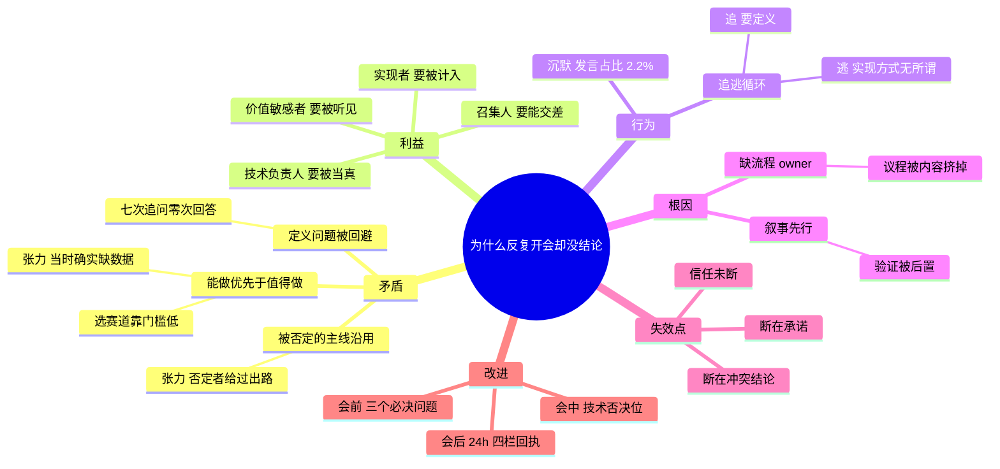

# 会议矛盾与沟通诊断（v3）

## 设计来源（构建思想）

本 skill 不是自创框架，而是整合了以下成熟方法：

- **三层冲突模型**（Task / Process / Relationship conflict）——区分"争什么"，并识别关系冲突伪装成任务/过程冲突（NVC Rising, 2026）
- **立场→利益**（Fisher & Ury, *Getting to Yes*, 1981）——position 是他说要什么，interest 是他为什么想要
- **Thomas-Kilmann 五种冲突模式**（1974）——竞争/合作/妥协/回避/迁就，按"坚持自身利益 × 照顾对方利益"两维划分
- **Lencioni 团队五障碍**——信任→冲突→承诺→问责→结果，用来诊断团队层断点
- **5 Whys / 鱼骨图**——把表层原因追到系统性因素
- **诊断三问**（Discassess, 2026）——task/process/status；急性/慢性；结构性/人际性
- **沟通杀手三模式**（36氪, 2026）——回避、指责、从众思维
- **中心问句与张力节点**（PromptABCD, 2026）——导图中心应是「要回答的问题」而非主题；每支须带一个 tension 节点，防止单向论证
- **StructSum 结构化生成**（arXiv 2401.06837）——思维导图生成要分别校验事实性、局部结构、全局结构三层
- **AAR 复盘图**（Concept Map Maker, 2026）——期望/实际/为什么/认知变化/下一步五支，节点须带触发条件与可复用产物

**做**：从逐字稿的互动结构里还原真实分歧、根因和失效点，产出可复用复盘结论。
**不做**：会议纪要、内容摘要、行动项整理（用 meeting-transcript-cleaner / meeting-minutes）。

## 输入

必需：逐字稿（带说话人标签最佳）。
尽量补：会议目的、参会人角色/部门、议题背景、最终决策。
缺失时先推断，并在报告开头列「分析假设」。不要卡住。

## 分析原则

1. **先诊断，后归因**：先判断冲突类型，再解释原因。类型错了，原因一定错。
2. **证据锚定**：每个判断指向具体发言或互动片段。
3. **区分事实与推断**：推断标置信度（高/中/低）+ 依据。
4. **看互动，不只看内容**：谁打断谁、谁沉默、哪个话题被快速带过，比观点更能暴露矛盾。
5. **不评价人，只分析模式**。
6. **最大的矛盾常是"没人反对的伪共识"**，不是吵架。

## 十步分析流程

### 第 0 步：三个诊断问题（先问自己，决定后面怎么分析）

1. 这个分歧是关于 **做什么（task）**、**怎么做（process）**、还是 **谁来决定（status/关系）**？
2. 它是 **急性**（某个事件触发）还是 **慢性**（长期积累、换个话题还爆）？
3. 如果换成另外两个人，这个冲突还会发生吗？会 → **结构性**；不会 → **人际性**。

把这三问的答案写进报告开头，它决定你后面用哪套工具。

### 第 1 步：事实层校准

- 列出各方引用的事实、数据、假设
- 标出：哪些是**事实**、哪些是**观点**、哪些是**未说出口的假设**
- 判断：大家是否在同一个事实底座上？如果事实不一致，先别谈立场——这是信息问题
- 关键句：「双方争的不是同一个事实」比「双方立场不同」更常见

### 第 2 步：冲突分类（三层 + 伪装识别）

对每个矛盾点标注：

| 类型 | 争什么 | 典型表现 | 处理方式 |
|---|---|---|---|
| **任务冲突** | 目标、内容、优先级 | 明确的观点对立，可辩论 | 用内容工具：澄清、摆数据、决策规则 |
| **过程冲突** | 方法、流程、角色、议程 | 表现为烦躁而非争论（"为什么要投票""谁定的这个流程"） | 直接命名流程问题，快速定规则 |
| **关系冲突** | 人、信任、被尊重/被看见 | 热度超过议题本身；同样的人换个话题继续冲突；方案总不奏效；散会后更沉默 | 不能用任务/流程工具解决，会压制；需先处理"未被满足的需求" |
| **身份/地位冲突** | 谁有决定权、谁被绕过 | 争"该谁拍板""为什么不经过我" | 明确决策权与角色边界 |

**关键判断**：关系冲突最常伪装成任务冲突（"我不同意这个方向"）或过程冲突（"这个流程不合理"）。识别信号是上面那四条。如果同一矛盾"解决了又回来"，大概率是关系层没动。

### 第 3 步：立场 → 利益（核心推理）

对每个主要方，做转换：

- **Position（他说要什么）**：原话
- **Interest（他为什么想要）**：用四个追问推断
  1. "为什么这对你重要？"
  2. "如果不用这个方案，你担心会发生什么？"
  3. "你最在意的是什么？"
  4. "对你来说，什么样的结果算好结果？"
- **底层需求**（关系冲突专用）：被听见、被认可、被尊重、不被绕过、不背锅

输出：`表面主张 → 真实利益 → 底层需求`。三层都要有证据或推断标记。

### 第 4 步：冲突行为模式（Thomas-Kilmann）

给每个关键人物在本次冲突中的行为模式打标：

| 模式 | 特征 | 本次是否合适 |
|---|---|---|
| 竞争 | 坚持己见、压过对方 | 紧急/安全/原则问题才合适 |
| 合作 | 找双方都满意的方案 | 重要议题+长期关系才值得花时间 |
| 妥协 | 各让一步 | 时间紧、权力对等、临时方案 |
| 回避 | 不表态、转移、推迟 | 只适合议题不重要或需要冷静期；长期回避会让问题发酵 |
| 迁就 | 放弃自己的诉求 | 议题对对方更重要时才合适；习惯性迁就会积累怨气 |

**用途**：解释"为什么这个会开不下去"——比如一方竞争、一方回避，就会形成"追-逃"循环；全员迁就则产生伪共识。

### 第 5 步：根因深挖（5 Whys）

对每个主要矛盾，连续问 5 次"为什么"，直到触及系统性因素：

示例链条：
> 为什么吵？→ 对上线时间有分歧
> 为什么时间分歧？→ 研发按工作量估，销售按客户承诺倒推
> 为什么估算口径不同？→ 没有共同的排期规则
> 为什么没有规则？→ 决策权在两个人手里，且从未对齐
> 为什么没对齐？→ **组织结构问题：双头管理**

最后判断：根因是 **结构性**（角色、流程、激励、决策权）还是 **人际性**（信任、历史积怨）。结构性问题的解法是改系统，不是"加强沟通"。

### 第 6 步：无效沟通清单（逐条对照，给证据）

| 模式 | 识别信号 | 后果 |
|---|---|---|
| **回避** | 核心问题被"后面再说"带过且再没回来 | 问题发酵 |
| **指责** | 从议题转向对人的评价（"你总是…"） | 防御升级 |
| **从众思维** | 没人反对就推进；"大家没意见吧" | 伪共识 |
| 各说各话 | 回应的是自己上一轮观点 | 无实质交锋 |
| 循环 | 同一论点 3 次以上无新增信息 | 时间浪费 |
| 抽象化 | 用"协同/赋能/对齐"掩盖具体分歧 | 分歧被模糊化 |
| 沉默成本 | 关键角色全程不发言，或只在末尾附和 | 隐患未暴露 |
| 数据缺席 | 靠印象争论，没人拿数据 | 无法收敛 |
| 决议悬空 | 讨论了但没定谁拍板、何时定 | 下次重开 |
| 礼节占用 | 开场/客套/表态占大量时间 | 议题被压缩 |

每条给：位置、证据、后果。

### 第 7 步：团队层诊断（Lencioni 五障碍）

判断团队断在哪一层：

1. **信任缺失** → 不敢暴露弱点 → 2. **害怕冲突** → 伪共识 → 3. **缺乏承诺** → 决议没人真认 → 4. **逃避问责** → 行动项无人跟 → 5. **忽视结果** → 各守各的 KPI

本次会议的失效点在第几层？这决定了改进的优先级：如果断在信任层，改议程没用。

### 第 8 步：改进设计（系统视角，不是"加强沟通"）

原则：**不是让冲突反应更好，而是重新设计产生冲突的条件。**

- **会前**：哪些分歧应先一对一解决；哪些数据必须提前发；谁必须到场
- **会中**：议程顺序（先定决策权再谈内容）；决策规则（谁拍板/共识/升级机制）；给沉默者留结构化的发言位
- **会后**：1 周 / 3 周两次跟进（研究显示无跟进则一个月内回弹）
- **结构层**：角色边界（RACI）、排期规则、双头管理是否要拆、激励是否冲突
- **关系层**：如果是关系冲突，安排不带议程的单独沟通，先处理"被听见"的需求

### 第 9 步：可复用归纳

- **模式命名**：如"研发-销售口径错位型""双头管理追逃型""伪共识-会后反弹型"
- **重复性问题**：这类会议历史上是否反复出现同一模式
- **下次检查清单**（5 条以内，可直接用）

### 第 10 步：思维导图呈现（结构可视化）

诊断报告是线性的，但矛盾成因是多因交织的。最后一步把前九步压成一张导图，让人 90 秒内看懂「问题长什么样、卡在哪、下一步动哪里」。

**导图不是报告的缩略版，是报告的索引。** 节点只放结论词，不放证据；证据留在正文。

#### 10.1 四条设计原则

1. **中心节点是一个问题，不是一个主题。**
   - 错：`赛前四次会议`（名词，不逼出判断）
   - 对：`为什么六场会开完还没结论`（疑问句，每个分支都要为回答它服务）
2. **一级分支＝诊断维度，不是会议时间线。**
   按「矛盾 / 利益 / 行为 / 根因 / 失效点 / 改进」切，不要按「会前 / 会中 / 会后」切——后者只是顺序，前者才是结构。
3. **每个矛盾分支必须带一个「反向张力」节点。**
   写明这个判断最可能错在哪（反证、边界、另一种解释）。作用是防止导图变成单向指控，也是导图可信度的来源。与「不评价人、只分析模式」原则一致。
4. **事实与推断用「层级 + 形状」双重区分，以层级为主。**
   一级＝诊断维度，二级＝判断，三级＝事实（时间点 / 原话 / 可核对动作）。这是主干手段：**飞书画板承接 Mermaid 时会抹平节点形状**（实测），所以语义不能只挂在形状上。形状（方形＝判断、圆角＝事实、六边形＝改进）只在 Mermaid 原生渲染时作为加分项。

#### 10.2 节点规则（硬约束）

| 项 | 规则 |
|---|---|
| 中心节点 | ≤ 15 字，且必须是疑问句或判断句 |
| 一级分支 | 5–7 个 |
| 层级深度 | 3–4 层，不超过 4 层 |
| 单节点字数 | ≤ 12 字；超了说明这一层该拆 |
| 每层子节点 | 2–5 个 |
| 节点内容 | 只放结论词 / 模式名 / 人名+角色；不放整句、不放引文、不放时间戳 |
| 跨分支关联 | Mermaid mindmap 是严格树，不支持跨分支连线；需表达「互相加强」时写成 `←与X共振` |
| 形状语义（可选） | 圆角 `( )`＝事实/原话；方形 `[ ]`＝判断/推断；六边形 `{{ }}`＝改进动作。**飞书画板会抹平形状，不能靠它承载语义**，证据等级以层级为准 |
| 节点总数 | 25–40 个。超过 40 说明把证据塞进了结构层，删节点，不要加层 |

#### 10.3 标准结构（六支）



> 注意：节点文字里带方括号/圆括号会被 Mermaid 解析成「id[显示文本]」，结果节点只显示括号里的内容。要么给节点起 id，要么干脆只用纯文本节点。

#### 10.4 输出与交付

- 报告正文末尾附折叠的 Mermaid 源码，便于二次编辑。
- 需要可视化交付时，用飞书画板承接 Mermaid（`<whiteboard type="mermaid">`）或渲染为 PNG；两种方式都保留源码。
- 导图之后补一段 2–3 句的「读图指引」：先看哪一支、哪一支是本次会议真正的断点。不做逐节点复述。
- **渲染自检**：用 `lark-cli whiteboard +export --output-type preview` 导出画板预览图，确认布局正常、文字未截断、根节点未被裁。飞书画板抹平形状属预期，不是失败。

## 输出模板

```markdown
# 会议诊断：[主题]

## 0. 分析假设与诊断三问
- 假设：
- 类型（task/process/relationship/status）：
- 急性 / 慢性：
- 结构性 / 人际性：

## 1. 事实层校准
（事实 / 观点 / 假设；是否同一事实底座）

## 2. 矛盾地图
### 矛盾 1：[命名]
- 表面议题：
- 冲突类型（含是否伪装）：
- 各方 position（原话锚点）：
- 强度 / 是否解决：

## 3. 立场 → 利益 → 底层需求
（逐方转换，标证据/推断）

## 4. 行为模式（TKI）
（谁竞争/回避/迁就/合作，是否匹配情境）

## 5. 根因链（5 Whys）
（为什么→为什么→…→系统因素；结构 or 人际）

## 6. 无效沟通清单
（模式 / 位置 / 证据 / 后果）

## 7. 团队层诊断（Lencioni）
（断在第几层，为什么）

## 8. 改进设计
- 会前 / 会中 / 会后
- 结构层 / 关系层

## 9. 可复用归纳
- 模式命名 / 重复性问题 / 下次检查清单

## 10. 思维导图
（Mermaid mindmap 源码：中心节点＝诊断问题；六支＝矛盾/利益/行为/根因/失效点/改进；每支 ≤5 节点，矛盾支必须带「反向张力」；总数 25–40 个）
（导图后接 2–3 句读图指引，不复述节点）
```

## 质量检查

- [ ] 先做了类型判断，再归因（没有把关系冲突当任务冲突）
- [ ] 每个矛盾都有原话或互动证据
- [ ] 每个推断都标了置信度和依据
- [ ] 做了立场→利益的转换，而不只是复述主张
- [ ] 做了 5 Whys，根因落到结构或人际层
- [ ] 至少识别出 1 个伪共识或被回避的问题
- [ ] 关注了沉默者、被打断者、被绕过者
- [ ] 区分了急性/慢性、结构性/人际性
- [ ] 改进行动具体到"谁、做什么、何时"
- [ ] 没有用内容摘要充数
- [ ] 没有把"说话难听"误判成"立场对立"
- [ ] 导图的中心节点是疑问句或判断句，不是会议名
- [ ] 每个矛盾分支都有「反向张力」节点（写明这个判断可能错在哪）
- [ ] 导图节点 ≤12 字、总数 25–40 个、深度 ≤4 层
- [ ] 用层级承载了证据等级（一级＝维度 / 二级＝判断 / 三级＝事实），没有只靠形状
- [ ] 没参会的人能在 90 秒内读懂导图主线

## 反模式

- 把会议内容复述一遍当分析
- 给每个人贴性格标签
- 只分析吵得凶的，忽略没人说话的议题
- 把所有分歧都归因为"沟通问题"
- 用任务层方案（改议程、加时间）去解决关系层冲突
- 推断不标置信度
- 改进建议写成"加强沟通""提高效率"
- 忽略权力不对等（下级不敢说、上级一开口就定调）
- 导图中心节点写成会议名称或主题词（写名词不会逼出判断）
- 导图按「会前 / 会中 / 会后」切分支（那是流程，不是诊断结构）
- 导图只画矛盾和根因、不画改进（导图沦为指控图）
- 把整段引文或时间戳塞进节点；导图超过 4 层或 40 个节点
